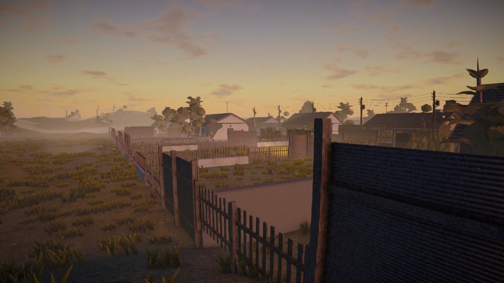
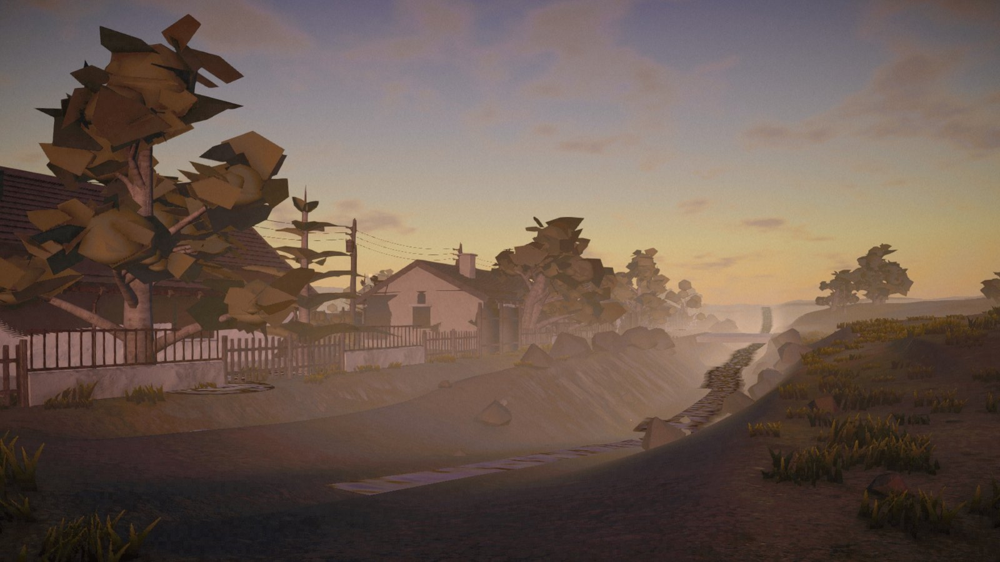
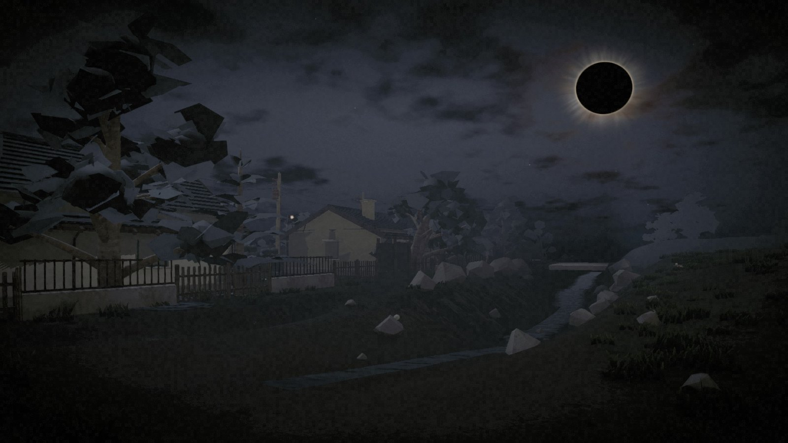
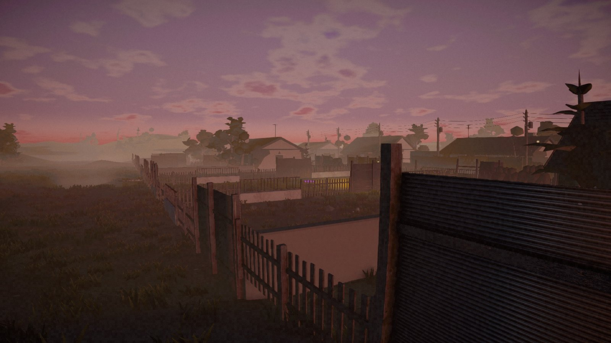

# Dusk Crew

**First-person co-op horror for one or two players. Free demo on itch.io when it's ready.**

Every light in the valley went out. You are the line crew sent back to turn them on. 
By day you build light. By night you walk out of it to bring people home. 
Something is watching from the dark, and the people it takes do not stay gone.

## Features

### Build by day, survive by night

Daylight is for work: fell trees, gather scrap, craft tools, and wire up lamp posts and a generator. When the sun goes, what you built is the only safe ground. You go out anyway, because people are sleepwalking in the dark and you are the crew that brings them home.

  
  

### The creature

It watches first. At dusk you catch its eyes on a perch above the street, then nothing. It takes people in the gaps your light does not reach, and nothing you carry can kill it. Light is the only thing it respects.

### The Returned

Anyone the creature takes can come back, and they come back wrong: black blades tear out of the body, and it hunts whoever watched it happen. Strong light melts the blades for about two seconds. That is your window to hit it. Then you burn what is left.

Everything is seen through a helmet camera. Human faces are mosaicked, the way footage is censored before release. The creature's never is.

### Holo-print

Tools are printed, not drawn. The wrist cuff projects a grid, traces the tool as a wireframe line by line, fills it with voxels, and it lands in your hands as worn wood and steel.

### Kinetic Rig

In development for the demo. Your tools float: a beam from the cuff tethers the axe beside you. Clench to strike. Flick to send it off to fell a tree on its own while you gather scrap. Lift the logs with the same beam and carry them home. It runs on a battery, and the creature can see its glow.

## Screenshots

  

## Devlog

**20 Nov 2026 — Tools leave the hands.** First step of the Kinetic Rig: an axe floats on a tether from the cuff and lands its first strikes in a greybox test. Sending it off to work alone is next.

**20 Nov 2026 — Holo-print.** Equipping a tool now prints it: grid, wireframe, voxels, then the real material.

**20 Nov 2026 — A whole day.** The district now runs dawn, noon, golden hour, dusk and a night under the black moon.

**17 Nov 2026 — The visor has a face.** Each teammate's visor shows a small face drawn in light, in their own colour, with seven expressions.

## Fact sheet

**Developer:** RAVYN 
**Genre:** First-person co-op horror 
**Players:** 1–2. Online co-op with a room code, or solo with a bot teammate 
**Platform:** Windows PC 
**Engine:** Unity (URP), Photon PUN 2 
**Demo:** Free on itch.io when it's ready 
**Status:** In development. Footage is from work-in-progress builds and test captures, and will change

## Press

You may use the images on this page in coverage of Dusk Crew. Please credit RAVYN.

Contact: [Discord — RAVYN: Riftfall](https://discord.gg/YMws83FPS) · [github.com/ravynarchlab-source](https://github.com/ravynarchlab-source)
