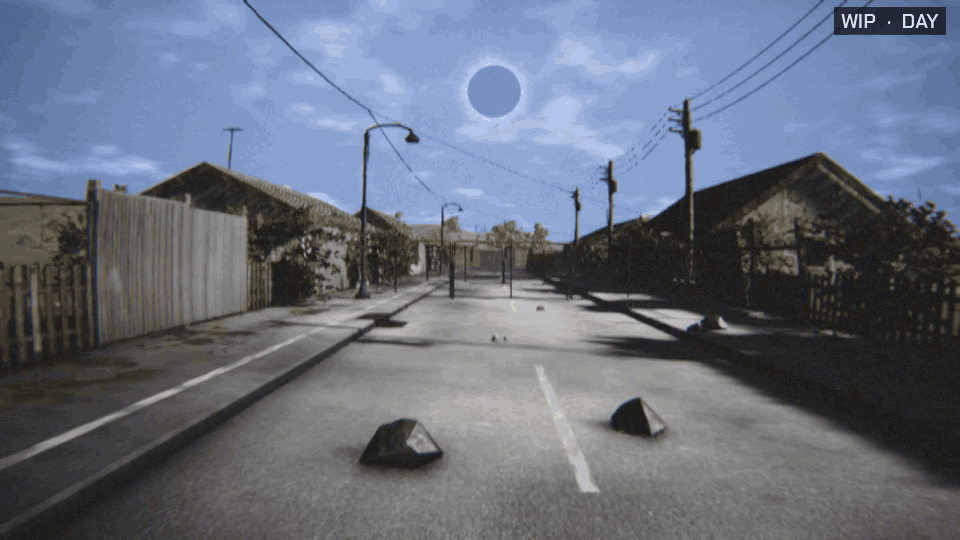
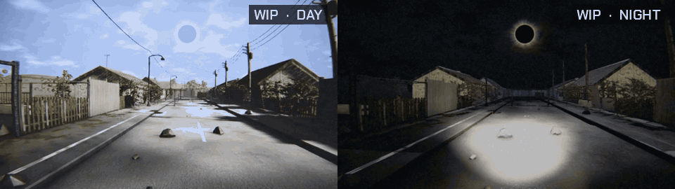
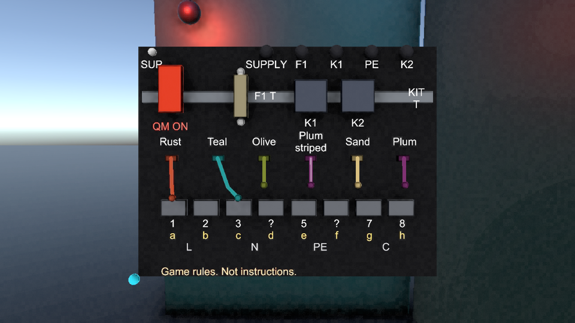
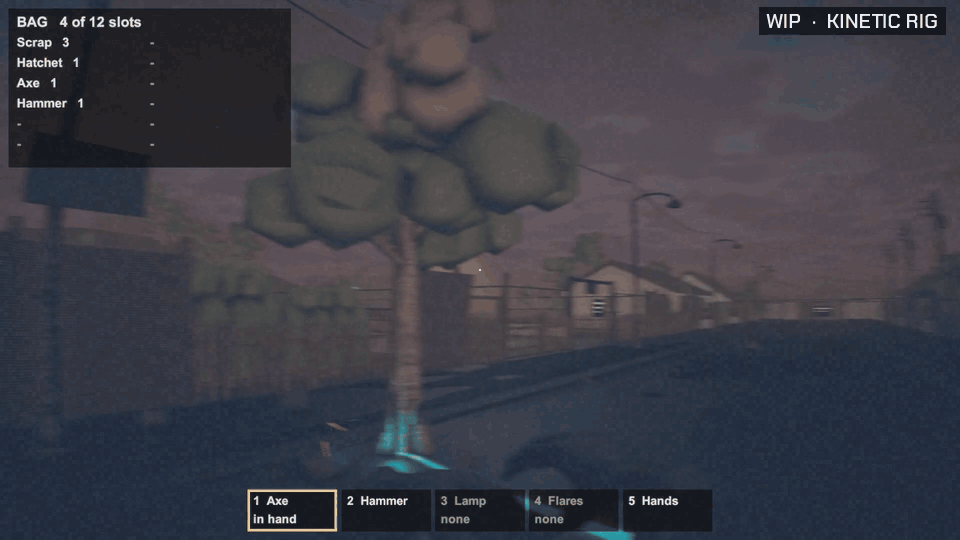
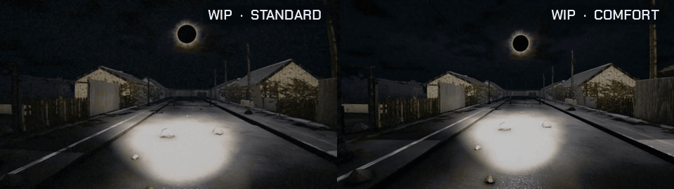
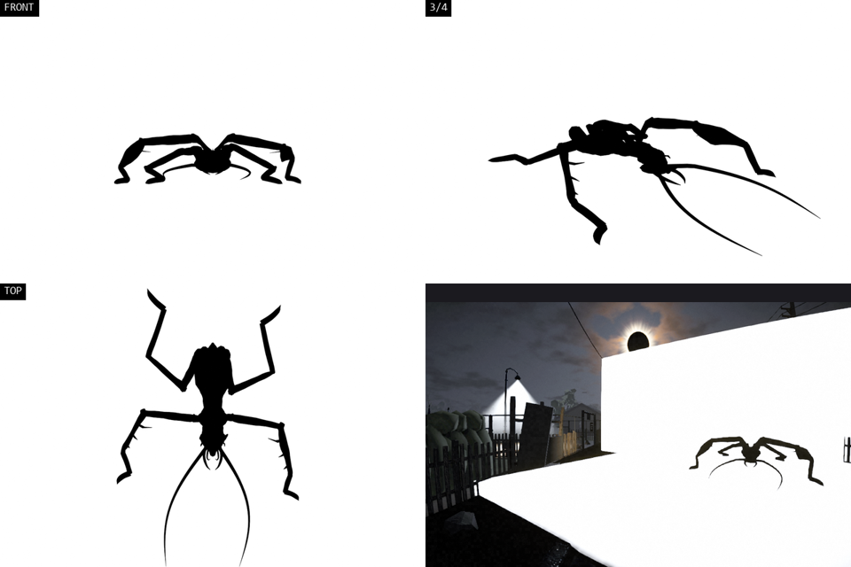
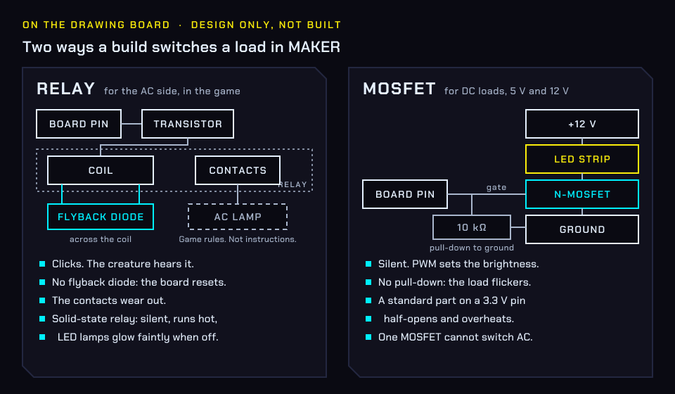

# Dusk Crew

**First-person co-op horror for one or two players. Free demo on itch.io when it's ready.**

Every light in the valley went out. You are the line crew sent back to turn them on. 
By day you build light. By night you walk out of it to bring people home. 
Something is watching from the dark.

## How a night works

## Systems

### Light and dark

The same street by day and by night. After dark, the light you carry and the lamps you build are the only safe ground. 
Lamps throw pools of light with dark gaps between them. The gaps are where the fear lives.

### The cabinet

One player wires the panel with their back to the street. The other guards them with the lamp and reads the wiring list off the cuff, because the Wirer cannot see it. Get it right and the street lamps come on one after another. 
**Footage coming:** the two-player take is next. This is a greybox still. The panel is game rules, not instructions.

### The Kinetic Rig

Your tools float on a beam from the wrist cuff. Send the axe off to fell a tree on its own, then lift the logs home with the same beam. 
In development. Not in the friend-test build yet.

### The bodycam

You see everything through the helmet camera: grain, lens bend, sway. Human faces are mosaicked, the way footage is censored before release. 
Standard on the left. Comfort on the right, for players who want a steadier picture. Every effect has its own slider.

### The creature

It is there from the first minute. It freezes when you look at it and moves when you look away. 
It cannot enter light: not the lamp's beam, not a lit lamp post. It waits at the edge and goes for whoever is left in the dark. A teammate's beam drives it off. You cannot kill it.

## Spoiler zone

I've been warned. Show me.

### The creature, stage 1

Stage 1 of the creature's body: the silhouette. Our own model, built by script, and the first stage to pass its review. Work in progress. 
Its two feelers never stop. They sweep ahead, tap the walls and turn toward any sound you make. A close-up is coming.

### The Returned

The creature takes your partner. Later something walks back up the road in your partner's suit, one foot dragging, head too far to the side. 
Close up, black blades tear out of the back and the arms. Hit it with the beam and the blades melt back for two seconds. That is your window. 
Words only for now. Footage comes when there is a clean capture.

## On the drawing board

> Design only. None of this is built.

**MAKER.** Real electronics inside the game: boards, sensors, LEDs, relays, motors. What works in the game works for real. Every 5 V and 12 V circuit can be exported as a real wiring diagram, parts list and code. Anything that would not work for real is marked "game only". The mains side stays game rules, not instructions. Lights you build help but never solve the night: the creature only flinches at them.

**LineNet.** An in-game network for the crew. It only works where you have restored the power.

## Devlog

**25 Nov 2026 — The creature's shape.** Stage 1 of its new body, the silhouette, passed its review. Next: its main forms.

**25 Nov 2026 — The cabinet works with two.** In a two-player network test, one player wired and one read, and the panel came out the same on both machines. Joining late and a dropped Wirer both hold.

**25 Nov 2026 — The bodycam look.** A fifth pass on the camera: grain, lens, light pools and the Comfort preset. Shown above as work in progress.

**25 Nov 2026 — Holo-Glass HUD.** Still mock-ups of a HUD projected from the cuff, in five states, from a calm day to a dead battery. Nothing in the game yet.

**25 Nov 2026 — Physical animation.** First tests of our own active ragdoll: dragging a downed teammate by the collar. Not there yet.

**24 Nov 2026 — The rig at work.** One take: the axe prints, fells a tree on its own, and the beam lifts three logs home.

**20 Nov 2026 — Holo-print.** Equipping a tool now prints it: grid, wireframe, voxels, then the real material.

**20 Nov 2026 — A whole day.** The district now runs dawn, noon, golden hour, dusk and a night under the black moon.

**17 Nov 2026 — The visor has a face.** Each teammate's visor shows a small face drawn in light, in their own colour, with seven expressions.

## Fact sheet

**Developer:** RAVYN 
**Genre:** First-person co-op horror 
**Players:** 1–2 in the demo. Online co-op with a room code, or solo with a bot teammate 
**Platform:** Windows PC 
**Engine:** Unity (URP), Photon PUN 2 
**Demo:** Free on itch.io when it's ready 
**Status:** In development. Everything on this page is work in progress (WIP) and will change 
**Footage:** full clips in the [Footage WIP release](https://github.com/ravynarchlab-source/dusk-crew-showcase/releases/tag/footage-wip)

## More

[How it plays](docs/HOW_IT_PLAYS.md) · [Systems](docs/systems/) · [Spoilers](docs/SPOILERS.md) · [Press](docs/PRESS.md) · [Credits](docs/CREDITS.md)

## Press

You may use the images and GIFs on this page in coverage of Dusk Crew. Please credit RAVYN. Details in [PRESS.md](docs/PRESS.md).

Contact: [Discord — RAVYN: Riftfall](https://discord.gg/YMws83FPS) · [github.com/ravynarchlab-source](https://github.com/ravynarchlab-source)
