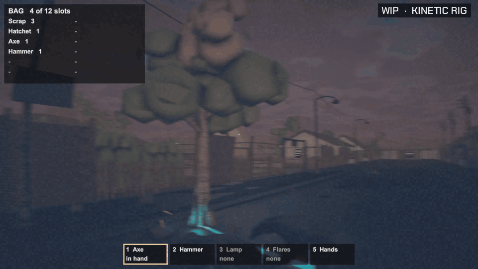
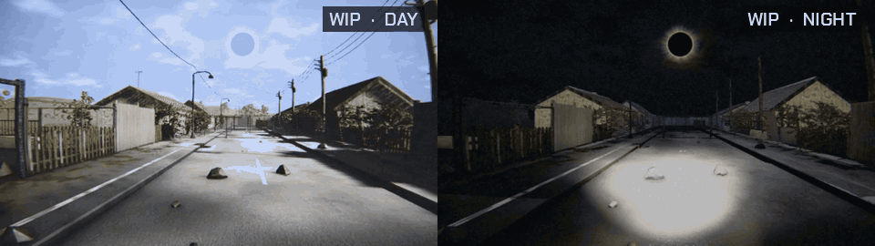

# How Dusk Crew plays

Work in progress. Everything here can change.

## The crew

You are a line crew: the people who keep the power on. One night every light in the valley went out. You were sent back to turn them on. Play with one friend online, or alone with a bot teammate.

## Day: build and wire

Daylight is for work. Fell trees, gather scrap, print tools from the wrist cuff, and wire lamps to the grid. What you build in the day decides how much of the night you can use.

## Dusk: something watches

The light fades. Far out past the lamps, something is watching. It freezes when you look at it and moves when you look away.

## Night: walk out of the light

People are sleepwalking in the dark. You go out to bring them home. The lamp you carry and the lamps you built are the only safe ground. Between the pools of light the street stays dark.

Stay together. Whoever is left in the dark is the one it goes for. A teammate's beam drives it off.

## Dawn: count who made it

Back in the light, the morning shows who made it home. Then a new day starts.

## Through the bodycam

Everything is seen through the helmet camera. Human faces are mosaicked. Comfort settings calm the picture down. See [The bodycam](systems/BODYCAM.md).

More: [Light and dark](systems/LIGHT_AND_DARK.md) · [The cabinet](systems/THE_CABINET.md) · [The Kinetic Rig](systems/KINETIC_RIG.md) · [The bodycam](systems/BODYCAM.md)
