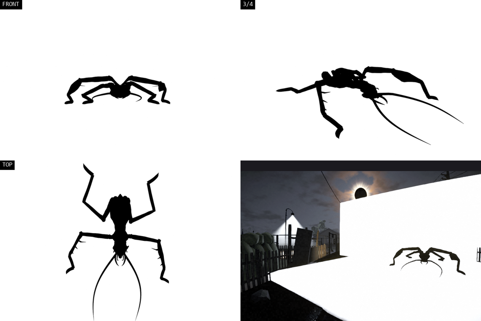

# Spoilers

**Content note:** Dusk Crew has blood and gore. The bodycam filters the worst of it with a mosaic.

This page shows the creature's body and describes the Returned. If you want to meet them in the game first, stop here.

I've been warned. Show me.

## The creature

- Stage 1 of its body: the silhouette. Our own model, built by script. Work in progress.
- Low and wide on four long legs. It rises to full height only to strike.
- Two feelers that never stop. They sweep ahead, tap walls, doors and the ground, and swing toward any sound you make. A brush from a feeler means it felt something. You have about a second.
- Its eyes are the only thing you see from far away.
- The creature is never mosaicked. Human faces always are.

## The Returned

- The creature can take your partner. Later something walks back up the road in your partner's suit, one foot dragging, head too far to the side.
- Close up, black blades tear out of the back and the arms.
- Hit it full with the lamp's beam and the blades melt back for two seconds. That is your window to hit it.
- Words only for now. Footage comes when there is a clean capture.

[Back to the page](../README.md)
