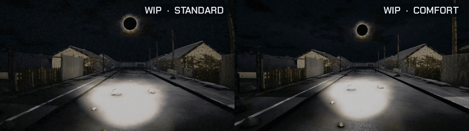

# The bodycam

Work in progress.

- You see the whole game through the helmet camera: grain, lens bend, head sway, a REC overlay.
- Human faces are mosaicked, the way footage is censored before release.
- Gore is filtered the same way: the camera blocks it.
- **Standard** is the authored look. **Comfort** is calmer and steadier.
- Each effect has its own slider: sway, lens bend, grain, shake, motion blur (off by default) and field of view.

[Back to the page](../../README.md)
