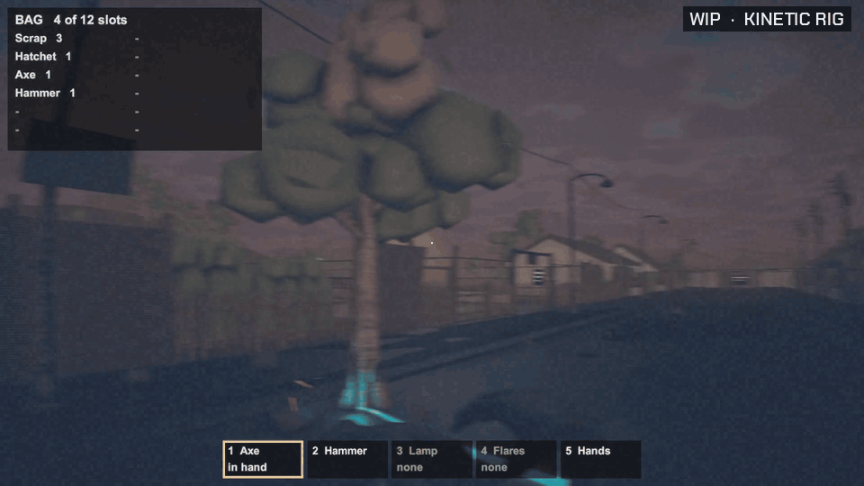

# The Kinetic Rig

Work in progress. In development, not in the friend-test build yet.

- Tools are printed from the wrist cuff: a grid, a wireframe, voxels, then wood and steel.
- The tool floats beside you on a cyan beam.
- Send the axe off to fell a tree on its own while you gather scrap.
- Lift the logs with the same beam and carry them home.

[Back to the page](../../README.md)
