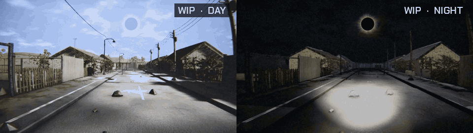

# Light and dark

Work in progress.

- By day the valley is safe and you build.
- At night the only safe ground is light: the lamp the crew carries and the lamp posts you wired up.
- Lamps throw pools of light. Between them the street stays dark. The gaps are where the fear lives.
- One lamp is handed between players. The moment it changes hands is the most dangerous second of the night.
- Whatever hunts in the dark cannot enter light. It waits at the edge.

[Back to the page](../../README.md)
