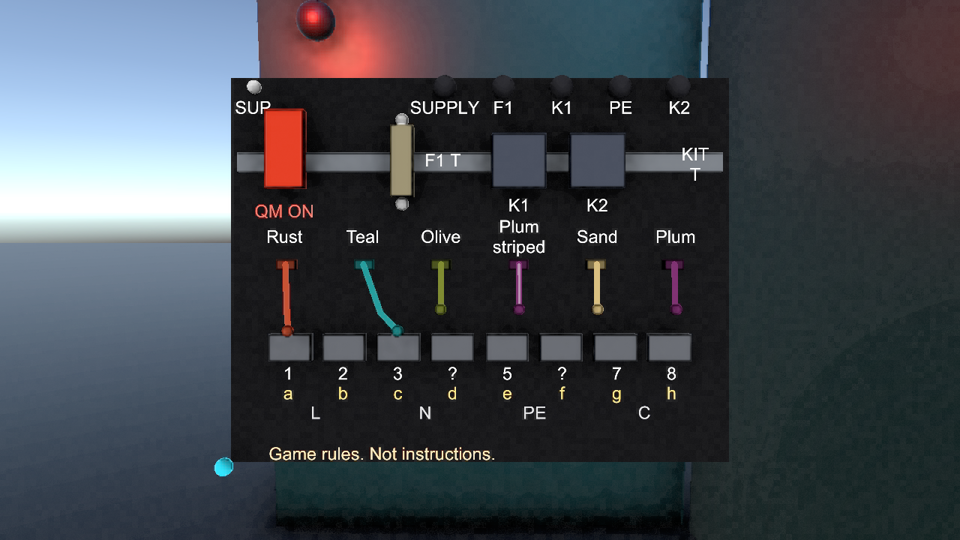

# The cabinet

Work in progress. Greybox. Two-player footage is coming.

The street lamps run from a cabinet on the corner. Fix it and the lights come back.

- **The Wirer** opens the panel. The view locks to the box, back to the street. They switch the main breaker off, then move the wires.
- **The Guard** stands behind with the lamp and reads the wiring list off the cuff. The Wirer cannot see that list, so you have to talk: "Where does Plum go?" "Four. Slot d."
- Close the breaker on a wrong wire and the panel arcs.
- Get it right and the street lamps come on, one after another, down the street.

Game rules. Not instructions. The panel is a puzzle, not a guide to real electrical work.

[Back to the page](../../README.md)
